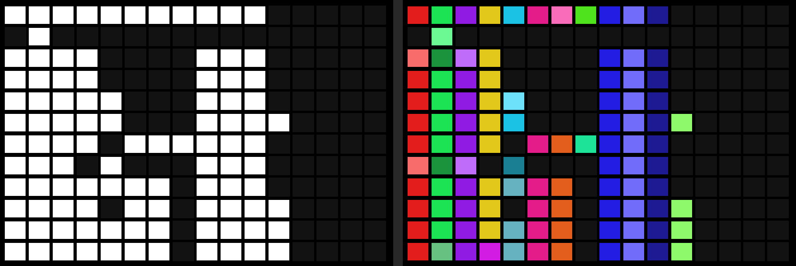

# colorsong: colored Song screen blocks

A patch for Polyend Tracker+ firmware 1.2.0. Each filled block on the Song screen
(one track in one pattern) gets a color from its content, so you can follow the same
material through a song at a glance. With the patch installed, Config shows the
firmware version as `1.2.0-c10`.



The same song on stock firmware (left) and with colorsong (right). Rows are song
slots, columns are tracks. In the second track, the one-hit snare in row 2 and the
main snare part in most other rows share the green family but get clearly different
shades. Rendered in the emulator with the firmware's own Song screen drawing code.

## What it does

- **Hue = instrument set.** Blocks that use the same set of instruments, e.g. {1} or
  {1, 2}, share a color family.
- **Shade = everything else:** which steps are filled, the notes, the instrument on
  each step, FX types and values, and the pattern length. Different content in the
  same family gets a clearly different shade (main, lighter, darker, muted, pastel,
  deep, then repeating).
- **Identical content, identical color**, in any column. A track copied to another
  track or pattern matches its original.
- **Colors follow the song.** The first time a project's Song screen is shown, colors
  are handed out in order of first appearance (top to bottom, tracks left to right).
  The first family is red, and each new family is a golden angle (137.5°) further
  round the color wheel, so families never look alike.
- **Colors stay put.** A family or variant keeps its color while it is in the song.
  An edit recolors only the edited blocks (and identical copies of them).
- **Every edit shows.** New content takes the next color in a rotation that nothing
  else in the song is using: 20 hues at least 12.5° apart, and 6 shades per family.
  A color an edit has just released only comes back once the rotation has gone round,
  so an edit never looks like it changed nothing.
- **Saved per project** as `<project folder>/colorsong.bin` (a few hundred bytes to
  about 5 KB), and loaded the next time that project's Song screen opens, so colors
  survive power cycles and project switches. Deleting the file resets the project's
  colors to song order. A damaged file is ignored. Colors of a project that has no
  name yet aren't saved.
- **Humanizing doesn't change colors.** Micro-move (`m`, FX type 2) and
  Volume/Velocity (`V`, FX type 18) are ignored, so timing and velocity variations
  keep a track's color. A step holding only one of them counts as empty. The list is
  `ignored_fx[]` in `colorsong.c` (type numbers from tracker-lib's `PatternFX` table).
- Tracks with no instruments (FX only) are drawn nearly gray. Tracks the firmware
  draws in its alternate color (`#444344`, probably muted tracks) keep their hue,
  darker and less saturated. Empty blocks keep the stock look.

## How it works

The patch code (4,149 bytes) is appended right after the stock image, at
`0x601bab80`. Its state, a 12,208-byte table, lives in the free tail of the 32 KB
on-chip OCRAM (`0x20205000`–`0x20207fff`), which nothing else in the firmware uses.
Firmware addresses and structures are described in [docs/FINDINGS.md](../../docs/FINDINGS.md).

| Hook | Where | What |
|---|---|---|
| `mt_usage_hook` | the 6 `bl pattern_update_track_usage` sites | Calls the original, then fingerprints all 16 tracks of the pattern into the table |
| `mt_song_enter` | `bl scr_song_set_grid_data` at `0x600fe402` (Song screen entry) | No file I/O. Resets the table if the project (name + path) changed, fingerprints the current pattern from RAM, starts a rescan, then calls the original |
| `mt_song_update` | Song screen vtable slot `0x60042dd8` (update method `0x600fdd38`) | Reads at most one pattern file per call for playlist patterns without a current fingerprint, redraws the grid, then runs the stock update. Loads and saves `colorsong.bin` |
| `mt_copy_hook` | copier call at `0x601145ce` (project open copies `pattern_NN.mtp` into `Workspace/patterns/`) | Drops the fingerprint of every pattern the copy replaces, so the next Song screen visit rereads it |
| `mt_color_hook_normal` / `_flagged` | the 2 filled-block `bl eve_color_rgb` in `song_grid_draw` | Assigns colors if the song or a fingerprint changed, then draws the block in its color (or the stock color if it has no fingerprint yet) |

- **Fingerprints.** Each track becomes a 16-bit key: a 7-bit family index and a 9-bit
  hash of everything else. The family registry keeps each instrument set's full
  32-bit hash, so different sets never share a family by accident.
- **Reading patterns.** The firmware only knows which tracks are used, not their
  content, so on the first Song screen visit after opening a project the update
  method reads each used pattern file once from `Workspace/patterns/`: one file per
  update, in pieces of at most 256 bytes, into a 0.8 KB stack buffer. Blocks fill in
  with color over the first moments on the screen. That's about 12 KB per pattern
  (14 patterns ≈ 170 KB; a project using all 255 patterns would read about 3 MB and
  pause visibly). Later visits only reread patterns whose track mask changed. The
  current pattern always comes from RAM, so unsaved edits count.
- **Assigning colors** happens only after that rescan is done. Hues and shades are
  kept per family and per variant while they are in the song, and handed out by the
  rotations described above.
- **Saving** uses the firmware's own file calls the way its pattern save does
  (remove, create, write in pieces of at most 256 bytes, close), only from the Song
  screen's update method, a short while after colors change, and only if something
  changed. `colorsong.bin` is a `CSG1` header with counts and an order-independent
  checksum, then 8-byte records keyed by content hashes (instrument-set key → hue;
  set key + content key → shade). Loading verifies the checksum before applying it.
- **Project switches and reopening.** The table resets when the project name or path
  changes. Reopening the same project after discarding changes is caught by the copy
  hook.
- **Not covered:** other code that rewrites `Workspace` pattern files outside the
  pattern save path and the project-open copy (none is known). Mod import hasn't
  been checked.

## Build

No compiler needed: the compiled patch is in `prebuilt/`. See
[docs/PATCHING.md](../../docs/PATCHING.md) for getting and checking the stock firmware.

```bash
python tools/patch_ptf.py path/to/TrackerPlus_1.2.0.ptf patch/colorsong/patch.json build/TrackerPlus_c10.ptf
```

To build the patch code from source, you need the Arm GNU Toolchain
(`arm-none-eabi-gcc` on `PATH`, or `ARM_GCC_BIN` set to its `bin` folder).
`build.sh` writes `patch/colorsong/build/`, which the patcher then uses instead of
`prebuilt/`:

```bash
patch/colorsong/build.sh
python tools/patch_ptf.py path/to/TrackerPlus_1.2.0.ptf patch/colorsong/patch.json build/TrackerPlus_c10.ptf
```

For troubleshooting your own changes there is a pass-through build, in which every
hook only calls the original (stock colors, no table, no file I/O, version text
`1.2.0-p10`). If a change freezes the unit, this tells you whether the hooking or
the logic is at fault:

```bash
CS_DEFS='-DCOLORSONG_VERSION="p10" -DCOLORSONG_PASSTHROUGH' patch/colorsong/build.sh
```

### Emulator tests

Run these before putting a changed build on hardware (needs `pip install unicorn
capstone numpy`). Project folders are copies of folders from the SD card's
`Projects/`.

```bash
python tools/emu/test_colorsong.py build/TrackerPlus_c10.ptf out/test_colorsong.png
python tools/emu/test_rescan.py build/TrackerPlus_c10.ptf "path/to/<project A>" "path/to/<project B>"
python tools/emu/song_grid.py build/TrackerPlus_c10.ptf "path/to/<project A>" out/song.png
```

- `test_colorsong.py` runs the patched firmware on synthetic patterns and checks 21
  color rules: copies are identical; a fill, a length change or an FX change gives the
  same hue with another shade; another sample gives another hue; humanizing (`m`,
  `V`) changes nothing; empty and not-yet-fingerprinted blocks keep the stock color;
  flagged tracks are darker; and the ordering rules (first family red, families at
  least 30° apart, variants clearly different).
- `test_rescan.py` runs Song screen entry and update calls against a fake SD card in
  33 scenarios: power-on, re-entry, project switch and back, unsaved edits, reopening
  without saving, saving and loading `colorsong.bin` (including a damaged file and an
  unsaved project), and a chain of edits that must each change the color. It also
  checks the file rules: no I/O on entry, at most one file per update, pieces of at
  most 256 bytes, and the stock update running every time.
- `song_grid.py` renders a real project's Song grid to a PNG with the firmware's own
  drawing code.

## Install and revert

Install as described in [docs/PATCHING.md](../../docs/PATCHING.md): copy
`TrackerPlus_c10.ptf` to `/Firmware` on the SD card next to the stock
`TrackerPlus_1.2.0.ptf`, then Config → Firmware → `TrackerPlus_c10.ptf`. Config should
show `1.2.0-c10 Build 1504`.

To revert: Config → Firmware → `TrackerPlus_1.2.0.ptf`. The `colorsong.bin` files can
stay (stock firmware ignores them) or be deleted.

If the unit freezes, pull the power, boot, and revert through Config. If it doesn't
boot, put only the stock `TrackerPlus_1.2.0.ptf` in `/Firmware` (from a computer),
power on with the card in, and press the pinhole button next to the USB-C port. The
bootloader reinstalls the stock firmware.
